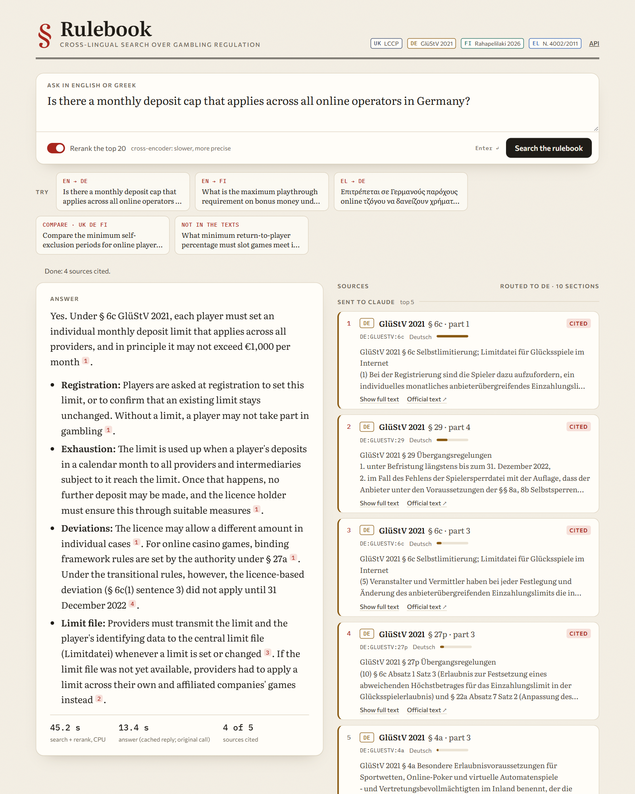
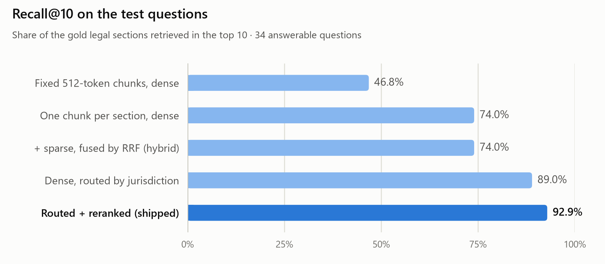
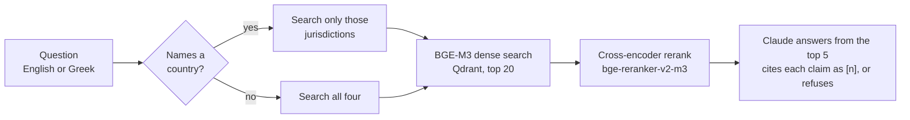
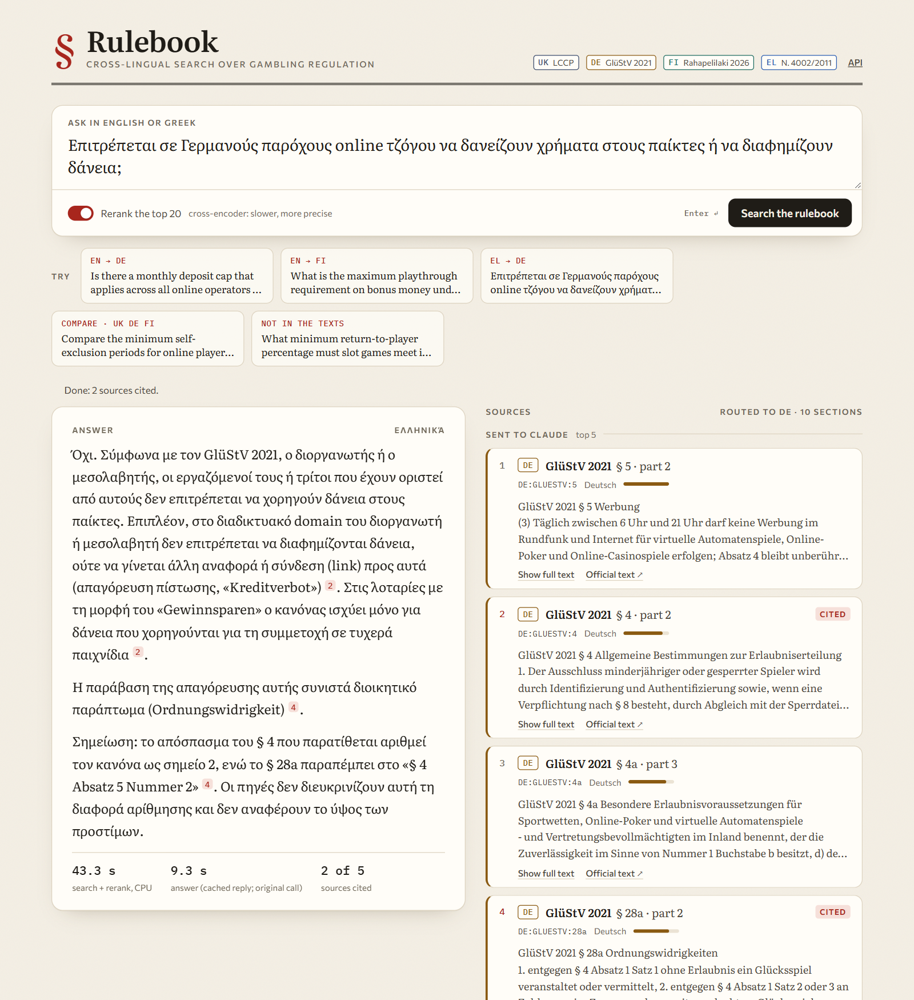
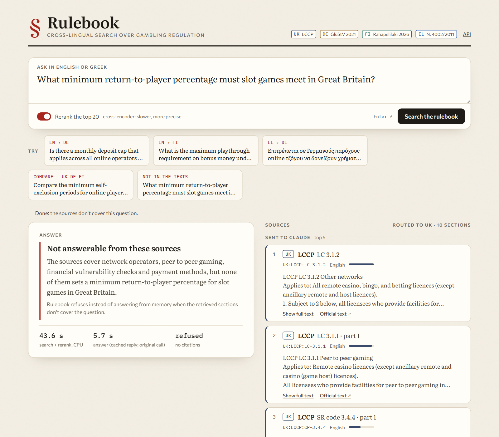

# Rulebook

[](https://github.com/kongrg/rulebook/actions/workflows/eval.yml)

**Cross-lingual RAG over gambling regulation in four countries.** Ask in English or Greek. The answer comes from the UK, German, Finnish or Greek legal text, cites the sections it used, or says the texts don't cover the question. A retrieval eval on 120 labelled questions measures every step, and CI fails a pull request that makes retrieval worse.



**The problem.** A compliance analyst asks in English: *"Is there a monthly deposit cap across online operators in Germany?"* The answer is in a German statute (GlüStV 2021 § 6c: *anbieterübergreifendes Einzahlungslimit*, €1,000 a month). The Finnish and Greek rules are written in Finnish and Greek, so an English keyword search finds none of it.

## Results

Measured on the 40 test questions, which were held out from every design decision and run once. All tuning used the 80 dev questions, and the dev numbers are in [eval/results/dev.md](eval/results/dev.md).

<picture>
  <source media="(prefers-color-scheme: dark)" srcset="docs/recall-dark.png">
  
</picture>

| Pipeline (test, 34 answerable questions) | Recall@5 | Recall@10 | MRR | nDCG@10 |
|---|---|---|---|---|
| Dense search | 73.0% | 74.0% | 0.665 | 0.646 |
| Hybrid: dense + learned keyword weights, RRF | 68.6% | 74.0% | 0.591 | 0.609 |
| Dense, routed by jurisdiction | 86.3% | 89.0% | 0.839 | 0.815 |
| **Routed + reranked (shipped)** | **89.2%** | **92.9%** | **0.862** | **0.844** |

**What moved the number.**
- **Routing, +15.0 points of recall@10.** Without it, English questions about German or Finnish law mostly retrieve UK sections. The UK text is the biggest part of the corpus and is in the question's language. In the shipped pipeline, every cross-language test question has its answer in the top 10.
- **Reranking, +3.9 points and a better top of the list** (MRR 0.839 → 0.862). Claude only sees the top 5, so that's the part that matters. It isn't free: on this CPU it is the slowest step by far, and two of the five remaining failures are the reranker reordering a correct list into a wrong one ([eval/ERRORS.md](eval/ERRORS.md)).
- **Hybrid search added nothing** (74.0% either way) and hurt the ranking (MRR 0.665 → 0.591). BGE-M3's keyword weights can't connect an English question to German text. On dev it was worse than dense (63.5% vs 69.7%), so it never shipped.
- **One chunk per legal section, not fixed 512-token windows:** 74.0% vs 46.8% with the same search. A section is the unit a compliance analyst cites, and its citation is part of what gets embedded.
- **Translating the query** into all four languages (an LLM call per question) is the obvious alternative to multilingual embeddings. On the 10 cross-language test questions it reached 80.0% recall@10, against 70.0% for plain dense and 100% for the shipped pipeline. Routing gets more, without the extra call.

**Answers.** Claude Sonnet 5.5 answers from the top 5 sections, and Claude Haiku 5.5 judges every claim against the source it cites.

| | Test | Dev |
|---|---|---|
| Unanswerable questions refused | 5 of 6 | 14 of 14 |
| Answerable questions wrongly refused | 1 of 34 | 6 of 66 |
| Faithfulness: claims the cited source supports | 90.0% | 92.0% |
| Citation precision: cited claims the source supports | 95.7% | 97.8% |
| Answers that cite a gold section | 97.0% | 95.0% |
| Search + rerank + answer, p50 / p95 | 59 s / 68 s | 71 s / 109 s |

- **Refusals:** 19 of the 20 unanswerable questions are refused. The exception is case #5 in the error analysis.
- **Faithfulness:** a claim with no citation counts as unsupported, which is most of the remaining 8–10%. Statements about what the sources *don't* cover aren't counted as claims ([why](DECISIONS.md#llm-calls)).
- **Latency is CPU time and mostly reranking.** On a 6-core desktop CPU, reranking 20 candidates takes about 50 s. Routed search takes about half a second. The answer call takes 5–15 s, including Claude Code start-up. On a GPU the reranker drops to well under a second, and the CPU-friendly alternative is routed search without the reranker, at 89.0% recall@10.

**Recommendation.** Ship routing plus reranking where a GPU is available. Where retrieval must run on CPU with an interactive budget, ship routing alone. It keeps most of the gain (89.0% vs 92.9% recall@10) at about half a second instead of a minute. Don't ship hybrid search on a cross-language corpus like this one, and don't pay for query translation when the question names the country.

## How it works



1. **One multilingual embedding model.** BGE-M3 puts questions and legal sections from all four languages in one vector space, so an English question lands near the German paragraph that answers it.
2. **Routing.** If the question names countries ("in Germany", "στη Φινλανδία", "GlüStV"), Qdrant searches only their law. Otherwise it searches all four.
3. **Rerank.** A cross-encoder reads the question and each of the 20 candidates together and reorders them.
4. **Grounded answer.** Claude gets the top 5 sections as numbered sources. It cites every claim as `[n]`, answers in the question's language, and replies `INSUFFICIENT_CONTEXT` when the sources don't cover the question.

Hybrid search (dense plus BGE-M3's learned keyword weights, fused with RRF) was the original design. The eval showed it losing to plain dense search on this corpus, so it stays in the table as a measured alternative instead of the default. [DECISIONS.md](DECISIONS.md) has the reasoning behind each choice.

## Demo

<table>
<tr>
<td width="50%"></td>
<td width="50%"></td>
</tr>
<tr>
<td>A Greek question about German law: routed to DE, answered in Greek from GlüStV § 4 and § 28a.</td>
<td>Not in the texts: the UK conditions don't set a slot RTP minimum, so it refuses instead of answering from memory.</td>
</tr>
</table>

```bash
uv sync
uv run python -m rulebook.corpus          # fetch and parse the four sources into data/sections/
uv run uvicorn rulebook.api:app           # http://127.0.0.1:8000 (indexes on first start)
```

Or with Docker: `docker compose up`, then open http://localhost:8000 (set `ANTHROPIC_API_KEY` for answers).

The page streams the sources as soon as search finishes, then the answer. Hovering a citation highlights its section, and every section links to the official text. `POST /ask {"question": "..."}` returns the same as JSON, and `/docs` has the OpenAPI page. A question can be linked as `/?q=...`.

## The eval

**120 questions, written for this corpus.**

| Type | Count | What it tests |
|---|---|---|
| Lookup | 50 | one rule in one country |
| Cross-language | 30 | asked in English or Greek, answered by German or Finnish text |
| Comparison | 20 | needs sections from two to four countries |
| Unanswerable | 20 | the corpus doesn't cover it, so the right answer is a refusal |

- **Labels are section IDs** (e.g. `DE:GLUESTV:6c`), so they work in every language and can be checked against the source.
- **Split:** 80 dev questions for tuning, 40 test questions run once for the final table.
- **Provenance:** Claude drafted the questions and labels from the section texts. A second, independent model pass then audited all 120 without looking at the retriever: it fixed 17, mostly by adding sections that answer just as directly. Human review is still pending, and [eval/LABELLING.md](eval/LABELLING.md) has the audit log and the checklist.

**Metrics.**
- **Retrieval, at section level:** recall@5, recall@10, MRR and nDCG@10. A chunk counts as the section it came from.
- **Answers:** faithfulness and citation precision (a Haiku judge checks each claim against the source it cites), plus correct and false refusals.
- **Kept separate on purpose:** when an answer is wrong, the first question is whether the right section was retrieved at all.

## The CI gate

On every pull request, [`.github/workflows/eval.yml`](.github/workflows/eval.yml) runs the shipped first stage (routed dense search) on the 80 dev questions. It fails the PR if recall@10 drops more than 1 point below [`eval/baseline.json`](eval/baseline.json). Sources, models and embeddings are cached between runs. It gates the first stage rather than the reranker because reranking 80 questions on a CPU runner takes over an hour, and the reranker can only reorder what the first stage found.

A deliberately bad change, 64-token chunks, run locally:

```text
$ uv run python -m eval.run --gate
section512 · routed: recall@10 87.1 (baseline 87.1, allowed drop 1.0)
PASS

$ RULEBOOK_CHUNK_TOKENS=64 uv run python -m eval.run --gate
indexing 4172 chunks for 'section64'
section64 · routed: recall@10 78.7 (baseline 87.1, allowed drop 1.0)
FAIL: retrieval regressed                                   # exit code 1, so the PR check fails
```

## What still fails

Five of the test questions fail in five different ways, written up in [eval/ERRORS.md](eval/ERRORS.md):
- On comparisons, one country's sections fill the whole list.
- The reranker prefers passages in the question's language.
- The reranker demotes the right section below a neighbour that uses the same vocabulary.
- Broad UK conditions crowd out the specific rule.
- An unanswerable question gets an answer from adjacent rules.

The first two have the same fix, a candidate quota per named country, and that is the next experiment.

## Run the eval

```bash
uv run pytest                                       # metrics, chunking, routing, corpus checks
uv run python -m rulebook.index section512 fixed512 # build both collections (CPU: ~20 min each, cached)
uv run python -m eval.run --split dev --generate    # all three experiments + answers -> eval/results/dev.md
uv run python -m eval.run --split test --generate   # once, for the final table
uv run python -m eval.run --gate                    # what CI runs
uv run python -m eval.run --reuse                   # rescore a saved run after a label fix, no search
uv run --with matplotlib python -m eval.chart       # docs/recall-*.png
```

Claude calls go through headless Claude Code (`claude -p`) on a Claude subscription by default, locked down to no tools, no MCP servers, no settings and an empty working directory. With `ANTHROPIC_API_KEY` set, they go through the Anthropic API instead. Replies are cached by prompt hash, so a rerun costs nothing.

## Corpus

Fetched by scripts and never committed: the reuse terms differ per source.

| Country | Source | Language | Notes |
|---|---|---|---|
| UK | Gambling Commission, Licence Conditions and Codes of Practice | EN | Open Government Licence |
| DE | Glücksspielstaatsvertrag 2021 (gesetze-bayern.de) | DE | all sections |
| FI | Rahapelilaki 10/2026 (Finlex open data) | FI | the new act; most of it in force from 1.7.2027 |
| EL | Ν. 4002/2011, arts 25–54 (taxheaven.gr) | EL | third-party consolidation; no official consolidated text online |

## Status and caveats

- **The question set is a careful draft, not a human-reviewed benchmark.** Claude drafted it from the section texts. A second, independent model pass audited it without looking at the retriever and fixed 17 of the 120. The human review checklist is in [eval/LABELLING.md](eval/LABELLING.md). Until that review is done, the numbers measure the system against an unreviewed label set.
- **Models:** Claude Sonnet 5.5 answers, and Claude Haiku 5.5 judges and translates. The experiments ran through headless Claude Code on a subscription. The Anthropic API path (`ANTHROPIC_API_KEY`) uses the same model IDs and prompts, but it hasn't been run.
- **Latency was measured on a 6-core desktop CPU with other jobs running.** Routed search takes well under a second. Reranking 20 candidates is the slow step, about 50 s per question here and well under a second on a GPU. Answer time includes 2–3 s of Claude Code start-up that an API call wouldn't have.
- **CI and Docker both run.** The first GitHub Actions run passed with the same recall@10 as local runs (87.1). `docker compose up` was checked on 4 Nov 2026: the page loads and search returns the right German section. Answers inside the container need `ANTHROPIC_API_KEY`, which is the untested API path above.
- **The corpus is a snapshot.** It was fetched on 27 Oct 2026, so rerunning the fetch later can change sections.

## Layout

```
rulebook/corpus/      fetch + parse the four sources into sections (one module per country)
rulebook/chunking.py  one chunk per section with its citation as a header; fixed windows for the baseline
rulebook/embed.py     BGE-M3, embeddings cached in SQLite
rulebook/index.py     Qdrant collections (local file mode, or a server via QDRANT_URL)
rulebook/search.py    dense, sparse, hybrid, routed, translate-the-query, and *_rerank
rulebook/answer.py    grounded answers with [n] citations, and the judge
rulebook/api.py       FastAPI: /ask, /ask/stream, the demo page
eval/                 questions, metrics, experiment runner, CI gate, results
```
